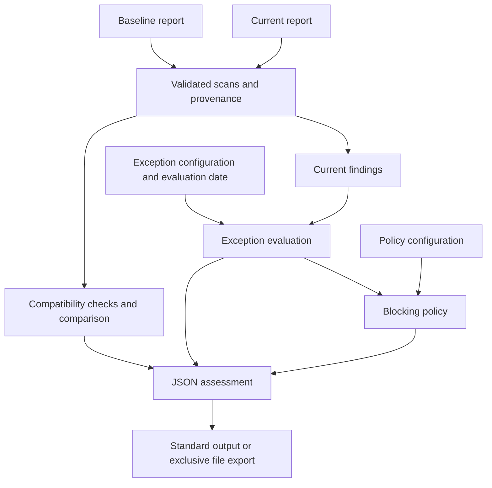

# IaC Security Gate

Explainable policy decisions and regression detection for Terraform
misconfiguration reports produced by Trivy.

This defensive Python project compares captured scans, applies explicit
time-limited exceptions and produces traceable JSON assessments.
It uses deterministic logic, not machine learning.

## Features

- Validate supported Trivy schema 2 Terraform reports.
- Reject incomplete summaries and inconsistent failure counts.
- Identify added, removed and unchanged findings.
- Preserve both versions of findings whose severity changes.
- Reject ambiguous duplicate finding identities.
- Evaluate all current findings against a configurable blocking policy.
- Apply exceptions scoped to a check, file, resource and exact severity.
- Retain applied, expired and unmatched exceptions in the assessment.
- Record scanner versions and SHA-256 fingerprints of input reports.
- Check observable scan compatibility and retain remaining warnings.
- Export complete reports without overwriting existing paths.

## Installation

Use Python 3.12 or newer. Run these Linux commands from the repository root:

```bash
python3 -m venv .venv
source .venv/bin/activate
python -m pip install -r requirements-dev.lock
python -m pip install --no-build-isolation --no-deps -e .
python -m pip check
```

The Python application has no third-party runtime dependencies.
Development and build versions are recorded in requirements-dev.lock,
without package artifact hashes.

Trivy is required to generate new scanner reports.
It is not required to evaluate the bundled captured reports.

## Quick Start

Compare the restricted fixture with the unrestricted SSH fixture:

```bash
iac-security-gate \
  --baseline tests/fixtures/trivy/restricted.json \
  --current tests/fixtures/trivy/unsafe.json \
  --policy config/policy.json \
  --exceptions config/exceptions.json \
  --allow-root-change
```

Expected result for these fixtures and the default configuration:

- Gate: `block`.
- One added finding: `AWS-0107`, severity `HIGH`.
- One blocking finding.
- Exit code: `1`.

The explicit root-change option is necessary because the example scans
come from different directories. In normal use, compare equivalent scopes
and consistent relative resource paths.

## Generate a Trivy Report

```bash
mkdir -p reports
trivy config \
  --misconfig-scanners terraform \
  --format json \
  --exit-code 0 \
  --output reports/current-trivy.json \
  examples/terraform/unsafe
```

The captured fixtures were generated with Trivy 0.75.0.
Downloaded check bundles may change independently of the scanner version.
New scan results must be observed rather than assumed to match old fixtures.

No Terraform deployment or cloud account is needed for these examples.

## Export an Assessment

```bash
iac-security-gate \
  --baseline tests/fixtures/trivy/restricted.json \
  --current tests/fixtures/trivy/unsafe.json \
  --policy config/policy.json \
  --exceptions config/exceptions.json \
  --allow-root-change \
  --output reports/assessment.json
```

The destination directory must exist. Existing output paths are refused.
Publication uses a temporary file and an exclusive hard link on a filesystem
supporting hard links. Use an output directory you control.

## Exit Codes

| Code | Meaning |
| --- | --- |
| 0 | Policy passed |
| 1 | Policy blocked |
| 2 | Analysis, output or usage error |

A blocking result is an expected security decision, not an application crash.

## Policy and Exceptions

The default policy blocks `HIGH`, `CRITICAL` and `UNKNOWN` findings.
Every current finding is evaluated, including findings already in the baseline.

The default exception file is empty.
An exception requires these exact fields:

```json
{
  "check_id": "AWS-0107",
  "target": "main.tf",
  "resource": "aws_security_group.lab_ssh",
  "severity": "HIGH",
  "justification": "Synthetic example only; not an operational approval.",
  "expires_on": "2026-10-12"
}
```

Place exception entries inside the `exceptions` array of the versioned
configuration. Expiration is exclusive: this example is inactive from
2026-10-12 onward. A change from HIGH to CRITICAL does not match it.

The current UTC date is used by default.
`--evaluation-date YYYY-MM-DD` supports historical replay and is recorded
as `explicit_replay`. Do not use a past replay date for operational CI decisions.

## Architecture



Finding identity uses the check ID, relative target path and resource.
Line numbers and severity are evidence rather than identity components.
A removed finding means absence from the current report, not proven remediation.

## Validation

```bash
python -m ruff check .
python -m ruff format --check .
python -m pytest -q
```

The latest observed local suite passed 196 tests.
A clean Git clone, fresh Python 3.14 environment, non-editable installation
and exported blocking assessment were also verified.

CI is configured for Python 3.12 and 3.14.
Remote results are pending until the workflow executes on GitHub.

Tests use captured synthetic reports and do not require Trivy downloads.
They validate application behavior, not real-world scanner detection accuracy.

## Security Considerations

Analyze only authorized configurations and scanner reports.
Keep real infrastructure reports, credentials and state files out of public Git.

Policy and exception files are security-sensitive inputs:
their modification must be reviewed by the repository maintainers.

Input fingerprints identify bytes; they do not prove authenticity.
Passing this gate does not establish overall infrastructure security.

## Limitations

- Only the documented Terraform report format is supported.
- Scanner versions are checked, but rule bundles and scan options are not verified.
- Equivalent scan coverage cannot be established from these reports alone.
- Missing resource identifiers can make finding identities ambiguous.
- Report content is trusted only as supplied evidence, not proof of cloud state.
- Input reports are loaded into memory; resource limits need further evaluation.
- Analysis and export currently target local workflows on Linux.
- Exceptions provide technical filtering, not an approval management system.
- No live cloud inspection, deployment or automatic remediation is performed.

## Future Work

- Capture and verify scan settings and check-bundle provenance.
- Add input resource limits and broader malformed-report tests.
- Extend scanner support through explicitly tested adapters.
- Evaluate comparison behavior on larger and more varied fixtures.
- Add a readable Markdown assessment renderer.

## Security Documentation

See [Security Considerations](SECURITY.md) for configuration trust,
data handling, replay dates and filesystem boundaries.

## License

Distributed under the [MIT License](LICENSE).
